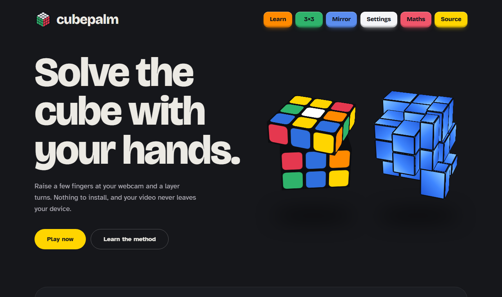
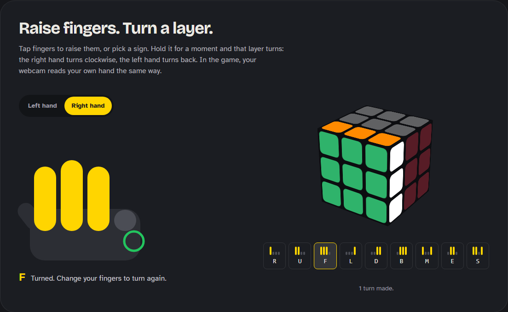
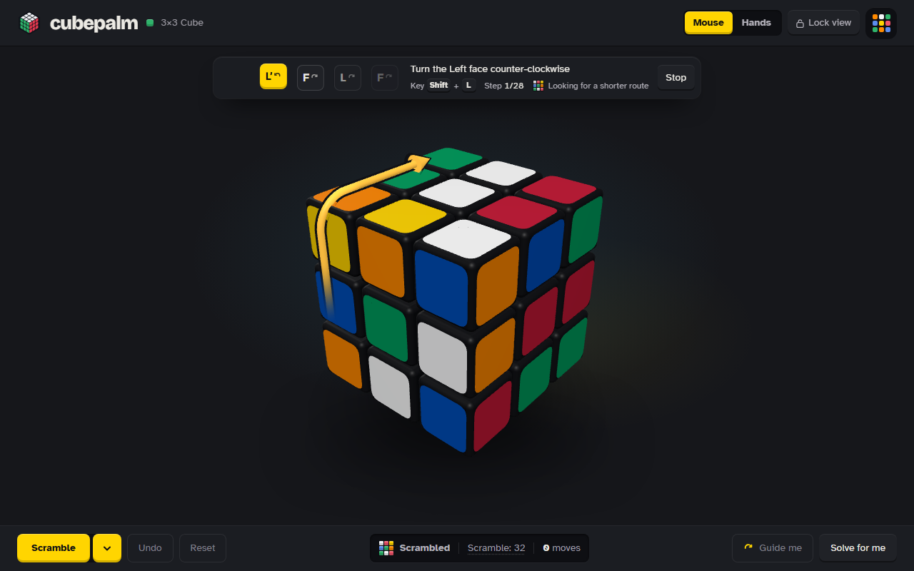
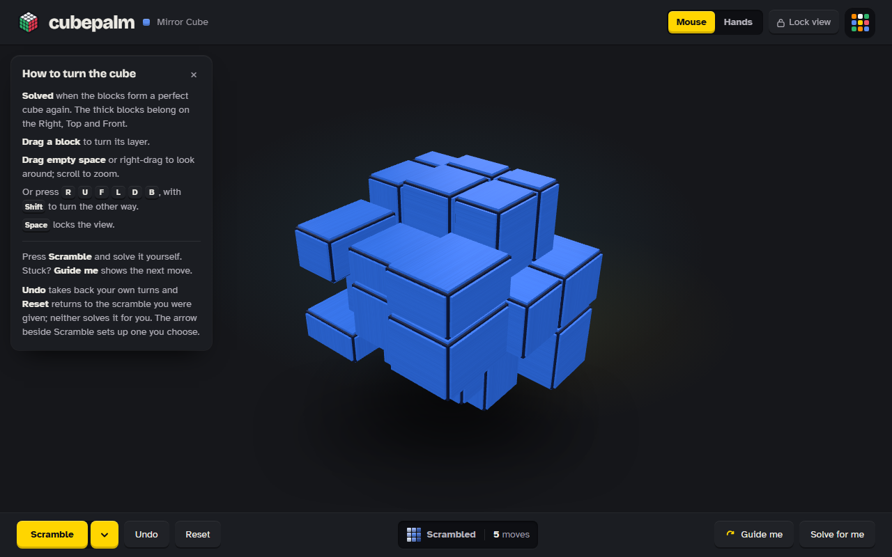
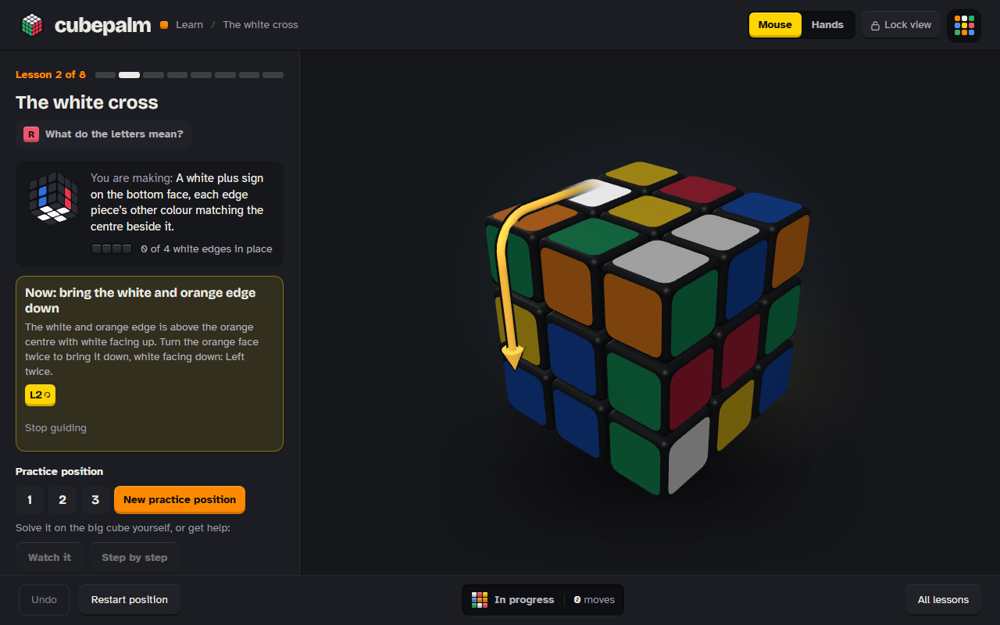

<div align="center">


# CubePalm

**Solve a Rubik's Cube with your hands.**

[**Live demo**](https://cubepalm.vercel.app) &nbsp;·&nbsp; [Run it locally](#run-it-locally) &nbsp;·&nbsp; [Help build it](#help-build-it)



</div>

## What it is

CubePalm is a Rubik's Cube and a Mirror Cube that run in your browser. Hold a few fingers up to your webcam and a layer of the cube turns. Hand tracking, solving and drawing all happen on your device, so there is no server and your camera feed never leaves it.

It is a passion project of mine. I wrote the solver from scratch, and I tried to measure the parts that can be measured. The name comes from the idea of a cube in the palm of your hand, with nothing in it: your open hand in front of a webcam is the controller.

## What you can do

<table>
<tr>
<td width="50%"><br /><b>Try a sign without a webcam.</b> Raise fingers, hold, and a real layer turns. The left hand is blue and the right hand is yellow everywhere in the app.</td>
<td width="50%"><br /><b>Guide me.</b> An arrow shows the next move on the cube, with the key and the finger sign beside it. You stay looking at the cube, not a list of moves.</td>
</tr>
<tr>
<td width="50%"><br /><b>The Mirror Cube.</b> One colour, uneven blocks. It is solved when the blocks make a clean cube again.</td>
<td width="50%"><br /><b>The Academy.</b> Eight short lessons, each with a goal that fills as you go, practice positions, a demo, and the fingers to use.</td>
</tr>
</table>

You solve the cube yourself by default. Ask for a guide and an arrow shows the next move. The right hand turns a layer clockwise and the left hand turns it back, so you never think about direction. Every layer turn is available, slices included, from a small alphabet of finger signs.

A scramble is the start of the attempt, and it stays that way. **Undo** takes back your own turns one at a time and stops at the scramble; **Reset** drops them all and returns to the same scramble with the clock at zero. Neither can walk back through the scramble to a solved cube. That is what **Solve for me** is for, and using it (or the guide) marks the attempt "with help".

The arrow beside Scramble sets up a scramble of your own: type or paste it (`R U2 F' L D2`), or tap it in with the on-screen buttons, to practise one position as often as you like. A scramble you chose does not count toward your best time.

### The signs

Four fingers, read as on or off. Counting from the index finger picks **R, U, F**; counting from the little finger picks **L, D, B**.

| Sign | Fingers up | Turns | | Sign | Fingers up | Turns |
|---|---|---|---|---|---|---|
| R | index | Right | | L | little | Left |
| U | index, middle | Top | | D | ring, little | Bottom |
| F | index, middle, ring | Front | | B | middle, ring, little | Back |
| M | index, little | Middle slice | | E | middle, ring | Equator slice |
| S | index, middle, little | Standing slice | | | | |

An open hand moving orbits the camera, two open hands spreading zoom it, and a closed fist held still locks the view.

## Run it locally

You need Node 20 or newer, and npm.

```bash
npm install      # also copies MediaPipe's runtime into public/
npm run dev      # http://localhost:5173
```

Hand control needs a webcam and `localhost` or https.

```bash
npm test                 # unit tests
npx playwright test      # end-to-end tests
npm run build            # type-check and production build
```

It deploys as a static site. Import the repository into Vercel; `vercel.json` has the build settings.

## How it works, briefly

The long version is in [`docs/MATH.md`](docs/MATH.md), and the [How it works](https://cubepalm.vercel.app/how) page on the site runs the real code: pose a model hand and watch both sign readers read it, run the solver and chart its route shrinking, and draw fair scrambles.

- **Reading your hands.** MediaPipe finds 21 points on each hand. CubePalm checks which fingertips are above their knuckles, takes a quick vote over a few frames so a flicker never counts, and turns a steady sign into a move.
- **Keeping track of a cube.** A cube is a list of where each piece is and how it is twisted. Every move rearranges that list, so undo, scramble and "is it solved?" are all simple.
- **Finding a short solution.** The solver splits the problem in two: first get the cube into a much simpler family of positions, then finish from there. It tries many ways of doing both, from six angles side by side, and keeps the cheapest, counting steps the way a person makes them. A random scramble comes out at about 24 steps; no position ever needs more than 26.
- **Proving it is the shortest.** A second search works through every cheaper possibility in order. If it finds one, that is the shortest route there is; if it rules them all out, the route in hand is proven shortest. That takes a blink near the end of a solve and would take hours on a fully scrambled cube, so the guide says "shortest possible" only when it has the proof.
- **Scrambling fairly.** Every scramble is one of the 43 quintillion possible cubes, picked with equal chance, the same way competition scramblers work. The cube comes from the browser's secure random generator, and a recent scramble is never repeated.
- **The Mirror Cube.** Each block remembers where it is and which way it is rotated, so the shape of the whole cube is the puzzle state.
- **Teaching.** Each lesson is a question asked of the cube ("are all four white edges in place?"), checked live to fill the progress bar. A teaching solver (`src/core/academy/teach/`) solves any cube with the same layer-by-layer method, one explained step at a time, and is tested against thousands of random cubes.
- **Checking.** Every solution and lesson is checked against a second, independent cube engine (cubing.js).

## What is measured and what is not

The parts that could be measured have been, by scripts in the repository that anyone can re-run (`npm run research`). The short version is in the [technical report](docs/REPORT.md).

| Question | Answer | Where |
|---|---|---|
| How well is a hand sign read, and what breaks it? | The shipped rule read 75.4% of signs on a hand model; a units error in the geometry accounts for much of the gap (89.9% once corrected). A stricter reader cuts a relaxed hand being read as a sign from 20.9% to 0.5%. Not yet measured on people. | [sign-recognition.md](docs/research/sign-recognition.md) |
| What do the vote, the hold and smoothing each buy? | Waiting 240 ms for a lost hand takes correctly turned signs from 68.6% to 97.5% when the tracker drops one frame in five. | [temporal-filtering.md](docs/research/temporal-filtering.md) |
| How short are the solver's routes? | 32.2 quarter turns at first answer (about 29 ms), 24.7 after five seconds, over 50 random cubes. Proven shortest for every position up to 8 face turns from solved; for no random cube within 5 seconds. | [solver.md](docs/research/solver.md) |
| Are scrambles fair? | 600,000 generated states: none unreachable, nine chi-square tests all within the 99.9% bound. | [scrambles.md](docs/research/scrambles.md) |
| Why can the answers be trusted? | Six claims with proofs: the bounds never over-estimate, the search is complete, the scramble generator is uniform. | [MATH.md](docs/MATH.md#why-the-answers-can-be-trusted) |
| How is it put together? | Threads, message protocols, failure paths, storage. | [ARCHITECTURE.md](docs/ARCHITECTURE.md) |

The gap is people. Every hand-reading number above comes from a model hand, not real ones, and that is the thing I most want to fix. If you have ten minutes and a webcam, you can help: [STUDY.md](docs/STUDY.md).

## What it needs, and what happens when it doesn't get it

| | Needs | If it is missing |
|---|---|---|
| **The cube** | WebGL, which every current Chrome, Edge, Firefox and Safari has | A message says how to turn hardware acceleration on. If the browser takes the graphics context away mid-session, the cube is rebuilt when it comes back |
| **Hands** | A webcam, and HTTPS or localhost (browsers only hand out the camera there) | A plain message says whether the camera is blocked, missing or busy. Mouse and keyboard keep working |
| **Hand tracking** | A background worker and a graphics card | Without the worker it runs on the main thread at a rate the device can afford; without the graphics card it uses the processor. Slower, still works |
| **The solver** | A background worker | If the worker fails to load, crashes or goes quiet, the solver moves to the main thread and carries on. If even that fails, the page says so and offers a retry; the cube stays playable |
| **Offline** | One visit while online | The app, fonts and solver are cached. Hand tracking is cached the first time Hands is used |

Camera frames never pass through React: the hand model runs in a worker, the skeleton is drawn straight to its canvas, and the 3D scene only redraws when something changes, so a cube sitting still costs nothing. On a touch screen a row of turn buttons stands in for the keyboard. On a phone the cube draws at a lower pixel ratio and the background search uses fewer workers, and that search pauses whenever the tab is hidden. Every push runs the type check, lint, unit tests and browser tests in GitHub Actions.

## How the code is laid out

```
src/
  components/    screens (Home, play, Academy, Settings), the 3D cube, the CSS cube, signs, player
  core/
    puzzles/     the 3×3 and Mirror Cube behind one small interface
    solvers/     the two-phase solver and the step-by-step guide
    gestures/    landmarks to signs, view lock, camera orbit, keyboard and mouse
    academy/     lessons, and the checks that decide a stage is done
  state/         small stores: puzzle, settings, Academy progress
research/        the experiments behind the numbers above (npm run research)
tests/e2e/       Playwright specs
docs/            the maths, architecture, the report, the study, screenshots
```

If you want somewhere to start reading, `src/core/gestures/` is where a hand becomes a move, and `src/core/solvers/` is the solver.

## Help build it

CubePalm is a passion project. It is not trying to change the world; I made it because I like it and I wanted to see how far a webcam and a browser could go. Now I would like other people who like this sort of thing to pick it up, understand it, and make it better.

Help would matter most in these places:

- **Reading hands more accurately on real hands.** The readers are only measured on a model so far. Real recordings would settle which one should be the default.
- **A faster solver and shorter routes.** A random cube still takes about 24.7 quarter turns after five seconds, and proving a route shortest only works near the end.
- **More puzzles.** The 3×3 and the Mirror Cube sit behind one small interface, so another puzzle should fit there.
- **Accessibility.** Not everyone can raise four fingers in front of a camera.
- **Tests, docs and translations.**

You do not have to ask first. Read the code, fork it, borrow an idea, or build your own version of the whole thing. [CONTRIBUTING.md](CONTRIBUTING.md) says how to get set up and what a good change looks like. If you would rather help without writing code, the friends' recording study in [docs/STUDY.md](docs/STUDY.md) takes about ten minutes.

CubePalm stands on MediaPipe for hand landmarks, three.js and react-three-fiber for the 3D, and cubing.js as the independent check on the cube.

## Built with

React 19 · TypeScript · Vite · Tailwind CSS v4 · three.js (react-three-fiber) · MediaPipe Tasks Vision · cubing.js · zustand · Vitest · Playwright

## Licence

MIT. See [LICENSE](LICENSE).

<div align="center">

Made by [Jay Guri](https://github.com/JayGuri)

</div>
