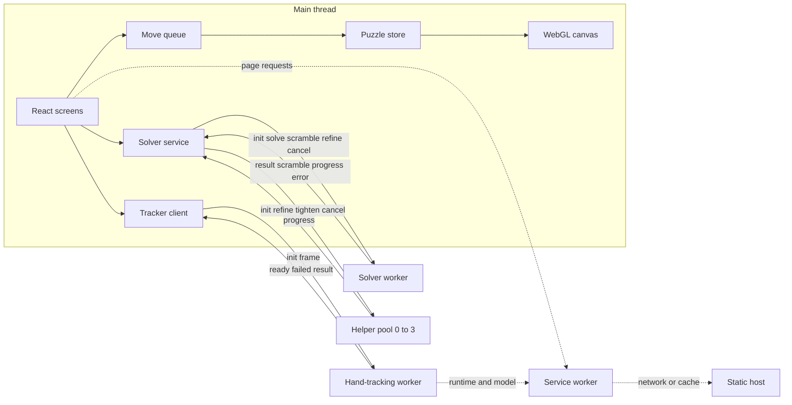
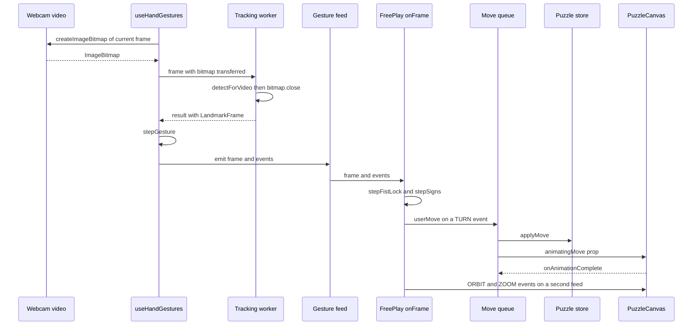
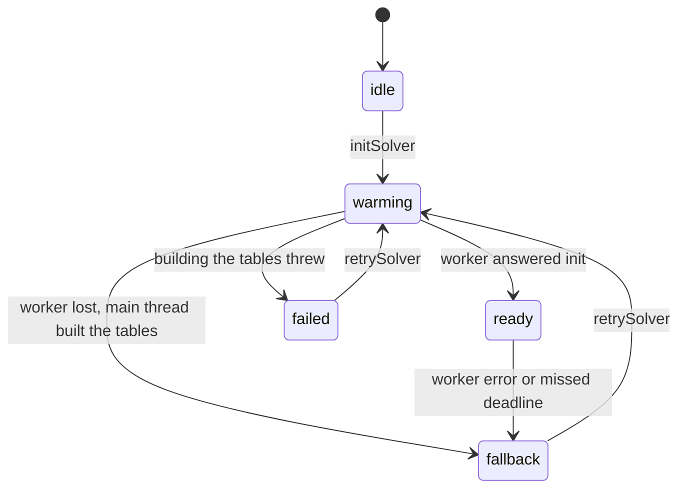

# CubePalm architecture

This document describes how CubePalm is put together: which code runs on which thread, how a camera frame becomes a turn of the cube, how the solver is kept alive, and what happens when a part fails. It is written for a reader who has not seen the code. The mathematics (cube coordinates, the two-phase algorithm, the optimality proof, the sign vote) is in [MATH.md](MATH.md) and is not repeated here.

Every statement below was checked against the source file linked beside it. Constants are quoted with their names so they can be searched for.

## 1. Overview

CubePalm is a static single-page web application with no server-side code. The browser downloads the files once and then does everything locally: it draws a Rubik's Cube with WebGL, reads hand landmarks (21 points per hand) from the webcam with a MediaPipe model, recognises finger signs from those landmarks, and searches for short solutions with a solver written for this project. The user interface is React; application state is held in three small zustand stores; long-running work is moved to web workers (background threads that exchange messages with the page) so that the page can keep drawing.

| Part | Where it runs | Main files |
| --- | --- | --- |
| Screens, routing, page metadata | Main thread | [App.tsx], [main.tsx], [pageMeta.ts] |
| Play screen and its hooks (move queue, attempt counters, guide) | Main thread | [FreePlay.tsx], [useMoveQueue.ts], [useSolveSession.ts], [useGuideState.ts] |
| 3D scene | Main thread, GPU through WebGL | [PuzzleCanvas.tsx] |
| Puzzle state | Main thread | [puzzleStore.ts], [PuzzlePlugin.ts], [registry.ts] |
| Camera loop, gesture state machine, sign recogniser | Main thread | [useHandGestures.ts], [GestureRecognizer.ts], [signGestures.ts], [fistLock.ts] |
| Hand landmark model | Hand-tracking worker; main thread if the worker cannot start | [handTracker.ts], [handTracker.worker.ts], [HandLandmarkerService.ts] |
| Solver service (lifecycle, timeouts, fallback) | Main thread | [kociemba.ts] |
| Solver search: solve, scramble, background refinement | Solver worker; main thread if the worker is lost | [kociemba.worker.ts], [kociembaCore.ts], [twoPhase.ts] |
| Extra background refinement | Helper worker pool, 0 to 3 workers running the same worker script | [kociemba.ts], [kociemba.worker.ts] |
| Offline cache and updates | Service worker generated by `vite-plugin-pwa` | [vite.config.ts], [main.tsx] |

Two puzzles exist, the 3x3 cube and the Mirror Cube. Both implement one interface, `PuzzlePlugin`, and are loaded on demand through `PUZZLE_REGISTRY` ([PuzzlePlugin.ts], [registry.ts]). The Mirror Cube reuses the 3x3 logic, scrambler and solver and adds a tracker for the position and rotation of each block ([mirror/index.ts]).

## 2. Threads and workers

Workers never talk to each other. The helper pool shares information only by way of the main thread, which forwards a `tighten` message when one helper reports a cheaper solution ([kociemba.ts]).

### 2.1 Solver worker

**Owns.** The solver's lookup tables and at most one background search job (`job`) at a time ([kociemba.worker.ts]). The worker file is a thin shim; the logic is in [kociembaCore.ts] and [twoPhase.ts], which are also imported by the main thread for the fallback path.

**Accepts** (`SolverRequest` in [kociemba.worker.ts]); every request carries a numeric `id`:

| `type` | Other fields | Effect |
| --- | --- | --- |
| `init` | `proofs?: boolean` | Builds the two-phase tables, replies, then builds the optimal-search tables in a later task unless `proofs` is `false`. |
| `solve` | `scramble: string`, `options?: SolveOptions` | Runs `solveScrambleDetailed` and replies with a `result`. |
| `scramble` | none | Replies with a new random-state scramble. |
| `refine` | `scramble: string`, `bound?: number`, `slice?: { index, count }` | Replaces the current job with a new `Refiner` and starts pumping it. |
| `tighten` | `cost: number` | Lowers the current job's target cost, if the `id` matches the job. |
| `cancel` | none | Drops the current job, if the `id` matches. |

**Sends** (`SolverResponse`): `{ id, ok, result?, scramble?, progress?, error? }`. A `solve` gets one reply with `result` (a `SolveResult`: `solution`, `cost`, `noneBelow`). A `scramble` gets one reply with `scramble`. A `refine` gets many replies with `progress` (a `RefineStep`: `solution`, `cost`, `done`, `optimal`), sent only when a slice found something cheaper or the search ended. `tighten` and `cancel` get no reply. Any thrown error becomes `{ id, ok: false, error }`.

**Scheduling inside the worker.** The background job advances in slices of 30 ms (`current.refiner.step(30)`) with a zero-delay timer between slices, so a `cancel`, `tighten` or `solve` message is handled between slices. One search may run for at most `SEARCH_BUDGET_MS = 12_000` ([kociemba.worker.ts]).

**Start and stop.** [App.tsx] imports the solver module on mount and calls `initSolver()`, on every route, so the tables are being built while the visitor is still on the home page. `getWorker()` creates the worker lazily with `new Worker(new URL('./kociemba.worker.ts', import.meta.url), { type: 'module' })`. It is never stopped in normal use. It is terminated only by `abandonWorker`, which runs when the worker raises an error or misses a deadline (section 5) ([kociemba.ts]).

### 2.2 Helper worker pool

**Owns.** Each helper is another instance of the solver worker script with its own copy of the two-phase tables and its own job. Helpers are sent `{ type: 'init', proofs: false }`, so they skip the optimal-search tables: they only run the two-phase search ([kociemba.ts]).

**Accepts and sends.** The same `SolverRequest` and `SolverResponse` types, but the service only ever sends helpers `init`, `refine` (with a `slice`), `tighten` and `cancel`, and only reads `progress` replies from them.

**Start and stop.** `ensurePool()` creates the helpers the first time a background search is requested. `releaseSolverPool()` terminates them; it is called when the play screen unmounts ([useGuideState.ts]) and, with `failed = true`, when a helper raises an error or the solver worker is abandoned. After a failure the pool stays disabled (`poolDisabled`) until `retrySolver()` ([kociemba.ts]).

### 2.3 Hand-tracking worker

**Owns.** One `HandLandmarkerService`, which wraps MediaPipe's `HandLandmarker` configured with `runningMode: 'VIDEO'` and `numHands: 2`. The WebAssembly runtime and the model are loaded from the application's own origin (`WASM_PATH = '/mediapipe/wasm'`, `MODEL_PATH = '/models/hand_landmarker.task'`), not from a CDN ([HandLandmarkerService.ts]).

**Accepts** (`TrackerRequest` in [handTracker.worker.ts]):

| `type` | Other fields | Effect |
| --- | --- | --- |
| `init` | none | Loads the runtime and model, trying the GPU first and then the CPU. |
| `frame` | `bitmap: ImageBitmap`, `timestampMs: number` | Runs detection on the bitmap, then closes the bitmap. |

**Sends** (`TrackerResponse`):

| `type` | Other fields | Meaning |
| --- | --- | --- |
| `ready` | `delegate: 'GPU' \| 'CPU'` | The model is loaded on that processor. |
| `failed` | `error: string` | The model could not be loaded. |
| `result` | `frame: LandmarkFrame \| null` | The hands found in one frame, or `null` if detection threw or the frame was skipped. |

**Start and stop.** The worker is created only when the user switches the play screen to Hands mode: `useHandGestures` runs only while `enabled` is true, and [FreePlay.tsx] passes `enabled: inputMode === 'hands'`. `startWorkerTracker` requires `Worker`, `createImageBitmap` and `OffscreenCanvas` to exist, posts `init`, and waits up to `WORKER_START_MS = 45_000` for `ready`. The worker is terminated by `dispose()`, which the hook calls when Hands mode is switched off or the screen unmounts ([handTracker.ts], [useHandGestures.ts]).

### 2.4 Service worker

The service worker is generated at build time by `vite-plugin-pwa` (Workbox) from the settings in [vite.config.ts] and is registered by `registerSW({ immediate: true })` in [main.tsx]. Its rules are described in section 9.

## 3. From camera to cube

**Camera.** `startCamera` asks `getUserMedia` for video only, with ideal size 640 by 480 and `facingMode: 'user'` ([camera.ts]). The camera request and the model load are started together with `Promise.all`, so the browser's permission prompt is not delayed by the model download ([useHandGestures.ts]).

**Frame loop.** A `requestAnimationFrame` loop on the main thread decides when to sample the video. It skips a tick if a detection is still in flight (`busy`), if the video has no current frame (`video.readyState < 2`), or if less than one interval has passed. The interval is `1000 / targetFps` with `targetFps = 25` when the model runs in the worker. When the model runs on the main thread the interval is `Math.max(baseIntervalMs, costMs * 3)`, where `costMs` is a smoothed measurement of detection time, so detection takes at most about a third of the main thread's time ([useHandGestures.ts]).

**ImageBitmap to worker.** The worker-backed `detect` copies the video's current frame with `createImageBitmap(video)` and posts it with the bitmap in the transfer list, which moves ownership to the worker instead of copying pixels a second time. Only one frame is in flight: if a result is still awaited, `detect` returns `null`, so a slow device drops frames instead of queueing them ([handTracker.ts]). The worker closes the bitmap in a `finally` block after detection ([handTracker.worker.ts]).

**Landmarks.** The service converts MediaPipe's result into a plain `LandmarkFrame`: `{ hands: [{ landmarks, handedness, score }], timestampMs }` ([HandLandmarkerService.ts], [landmarks.ts]). Nothing downstream imports MediaPipe types, which is what allows the recognisers to be unit tested with synthetic frames.

**The gesture feed.** Each frame is passed through `stepGesture`, a pure state machine that produces camera-level events such as `ORBIT` and `ZOOM` ([GestureRecognizer.ts]), and is then published with `feed.emit(frame, events)`. The feed is a set of listener functions with `subscribe` and `emit`. It is deliberately not React state. The comment on `GestureFeed` in [useHandGestures.ts] gives the reason:

> Camera frames as they arrive, about 25 a second. This is deliberately not React state: a screen that re-rendered on every frame spent most of its time re-rendering. Whoever needs a frame subscribes, does its sums outside React, and only sets state when something a person can see has changed.

There are three subscribers. [CameraDebugOverlay.tsx] draws the hand skeleton directly onto a 2D canvas. [GestureConfidenceIndicator.tsx] sets state only when the confidence band changes. [FreePlay.tsx] runs the recognisers described next and quantises what it shows: the hold ring advances in steps of 1/12 and the lock ring in steps of 1/20, and state is set only when the quantised value changes.

**Sign recogniser.** `stepSigns` in [signGestures.ts] is a pure function from (previous state, frame) to (next state, events). For each hand it:

1. ignores the hand if its score is below `minScore: 0.5`;
2. reads a four-character pose, one character per finger from index to little finger, where by default a finger is extended if its tip is more than `extendedRatio: 1.4` hand-scales from the wrist (`distanceReader` in [poseReaders.ts]);
3. appends the pose's layer to a window of the last `voteWindow: 6` frames and recognises a layer only if it has at least `votesToSelect: 4` of them;
4. starts a hold timer when the recognised layer changes, and emits one `TURN` event when the layer has been held for `holdMs: 550` and the current frame itself shows that sign;
5. marks the hand as `fired`, so the same sign cannot turn again until the recognised layer changes.

The right hand produces the clockwise turn and the left hand the counter-clockwise turn (`notationFor`). MediaPipe's handedness label is used as given; the `swapHands` setting inverts it ([signGestures.ts], [settingsStore.ts]).

**Fist lock.** In the same callback, `stepFistLock` toggles the view lock when exactly one hand is a fist for `FIST_LOCK_HOLD_MS = 900`, and then requires the fist to be released before it can toggle again ([fistLock.ts]).

**To the queue, store and canvas.** Each `TURN` event's move is passed to `userMove`, the same function that keyboard, mouse drag and touch buttons call ([FreePlay.tsx]). From there the move follows the path in section 4. The 3D canvas receives only `ORBIT` and `ZOOM` events, on a second feed owned by the play screen, and `ORBIT` is withheld while any sign is recognised so that holding a sign does not move the camera ([FreePlay.tsx], [PuzzleCanvas.tsx]).

**Testing seam.** In development builds only, `useHandGestures` exposes `window.__cubepalmInjectFrame`, which feeds a synthetic `LandmarkFrame` into the same `processFrame` function the camera loop uses. The browser tests use it because continuous integration has no camera ([useHandGestures.ts], [hand-signs.spec.ts]).

### 3.1 Two ways of reading a sign, and a lost hand

How a pose is read from one frame is a replaceable function (a `PoseReader`, in [poseReaders.ts](../src/core/gestures/poseReaders.ts)). Settings chooses between two pipelines, assembled in [signReading.ts](../src/core/gestures/signReading.ts):

- **Classic** (the default): the distance rule described above, on the landmarks as MediaPipe gives them.
- **Precise**: the landmarks are first smoothed per hand with a One-Euro filter ([oneEuro.ts](../src/core/gestures/oneEuro.ts)), then converted to square pixels using the picture's width over height (carried on each frame as `aspect`), then read by a rule with a dead zone: a finger is raised when clearly straight, folded when clearly bent, and otherwise neither, so a relaxed hand makes no pose. Its thresholds are generated by the recognition study and live in `trainedReaders.ts`.

In both, a hand the tracker fails to report for up to `dropGraceMs` (240 ms) changes nothing: the vote and the hold carry on when it returns, and no turn is made on a frame with no hand in it. The measurements behind these choices are in [research/sign-recognition.md](research/sign-recognition.md) and [research/temporal-filtering.md](research/temporal-filtering.md).

## 4. The move queue and the start of an attempt

### 4.1 One queue for every turn

`useMoveQueue` holds a first-in, first-out array of moves. Every source of turns ends in `enqueueMoves`: the user's drags, keys, signs and touch buttons (through `userMove`), the dealt scramble, and the solution player ([useMoveQueue.ts], [FreePlay.tsx]).

`drainQueue` takes one move at a time and calls `applyAnimated`, which does two things in order. First it applies the move to the puzzle store, so the logical state is correct immediately and the solver always sees the true position. Then it sets `animatingMove`, a prop of the canvas, and waits for the canvas to call `onAnimationComplete` before starting the next move. While a turn is drawn, the canvas keeps showing the pre-move colours from its own `colorState` and switches to the store's state when the rotation ends ([PuzzleCanvas.tsx]).

All callers of `drainQueue` receive the same promise for the drain in progress (`drainPromiseRef`). Awaiting it therefore means "until the queue is empty", which is how the Guide and Solve buttons wait for pending turns to land before reading the position ([useMoveQueue.ts], [FreePlay.tsx]).

### 4.2 The animation watchdog

The store already holds the move when the animation starts, so only the drawing can be late. If the canvas never reports back, the queue must still advance. `applyAnimated` therefore starts a timer that calls the completion handler itself after `ANIMATION_WATCHDOG_MS = 3000`, or after 0 ms when `document.hidden` is true, since browsers pause animation frames in hidden tabs. The comment lists the cases it covers: no WebGL, a lost graphics context, and a hidden tab ([useMoveQueue.ts]).

### 4.3 Flushing and generations

Anything that replaces the cube (Scramble, Reset, a custom scramble, a lesson position, leaving the screen) first calls `flushQueue`. It empties the queue, ends the turn in flight, and increments `generationRef`. An operation that was waiting across an `await` compares the generation it captured with the current one and stops if they differ. `handleScramble` does this twice: after the scramble arrives from the solver and after the scramble has been dealt ([useMoveQueue.ts], [FreePlay.tsx]).

The same pattern, a counter that invalidates late answers, is used in three other places: `loadGeneration` for puzzle loads ([puzzleStore.ts]), `guideTokenRef` for guide requests and background search updates ([useGuideState.ts]), and `solveTokenRef` for "Solve for me" ([FreePlay.tsx]).

While a scramble is being dealt, `busyRef` is true and `userMove` returns at once, so a key pressed during the deal is ignored and cannot be buried in the middle of the scramble ([FreePlay.tsx]).

### 4.4 The `startLength` rule

The puzzle store keeps `moveHistory`, the list of every move applied since the solved state, and `startLength`, the number of leading moves that set the puzzle up and are not the player's own ([puzzleStore.ts]).

| Action | Effect on the store |
| --- | --- |
| `load`, `reset` | Solved state, empty history, `startLength = 0`. |
| `markStart` | `startLength = moveHistory.length`: the current position becomes the start of the attempt. |
| `undo` | Does nothing if `moveHistory.length <= startLength`; otherwise applies the inverse of the last move and removes it. |
| `resetToStart` | Rebuilds the state by replaying the first `startLength` moves on a solved puzzle and drops the rest. |

The play screen calls `markStart` after a random scramble has finished dealing, after a custom scramble is applied, and after a lesson's practice position is set up. The Undo and Reset buttons are enabled only while `moveHistory.length > startLength`. The result is that Undo stops at the scramble and Reset returns to the scramble; neither can reach the solved cube by walking back through the scramble ([FreePlay.tsx], [PlayActions.tsx]).

The attempt's counters live beside the store in `useSolveSession`: the move count in quarter turns, a timer that starts on the first turn after a scramble, an `assisted` flag set by the guide or the solution player, and a `ranked` flag that is false for a scramble the player chose. Only an unassisted, ranked attempt can update the stored best result ([useSolveSession.ts]).

## 5. The solver service

The algorithm is described in [MATH.md](MATH.md), section 8. This section covers the service around it, which is all in [kociemba.ts].

### 5.1 Status

`SolverStatus` is `'idle' | 'warming' | 'ready' | 'fallback' | 'failed'`. The status is module-level state with a listener set (`subscribeSolverStatus`, `getSolverStatus`). [App.tsx] mirrors it into the attributes `data-solver-state` and `data-solver-ready` on the root element, and [FreePlay.tsx] reads it with React's `useSyncExternalStore`. `initSolver` returns the same promise if called again while running or after success. `retrySolver` clears `workerDisabled` and `poolDisabled` and starts again with a fresh worker.

### 5.2 Request timeout and main-thread fallback

Every one-shot request (`init`, `solve`, `scramble`) goes through `ask`. It posts the request, records a pending entry under its `id`, and starts a timer of `thinking + ANSWER_GRACE_MS`, where `ANSWER_GRACE_MS = 12_000` and `thinking` is the time the worker was told it may use: `timeMs + proveMs` for a `solve`, and 0 for `init` and `scramble`.

If the timer fires while the request is still pending, or the worker raises an `error` event, `abandonWorker` runs. It sets `workerDisabled`, terminates the worker, rejects every pending request, releases the helper pool, and moves the status from `ready` to `fallback`. `ask` catches the rejection and, because the worker is now disabled, answers the same request with `answerInline`, which calls the same core functions on the main thread. A caller therefore always receives an answer. An error that the solver itself reports for a request (for example an invalid algorithm) is not treated as a lost worker and is passed to the caller.

The time a `solve` may use depends on the requested effort (`EFFORT`):

| Effort | `timeMs` | `proveMs` | Used by |
| --- | --- | --- | --- |
| `quick` | 400 | 300 | The guide's first route |
| `normal` | 3000 | 1000 | Solve for me |
| `thorough` | 6000 | 3000 | Defined, not requested by any screen at present |

`solveFromHistory` also computes a second candidate without the solver: the history inverted, with cancelling moves merged. It returns whichever candidate costs fewer quarter turns. The solver takes the move history, not the cube state, as input; slice turns and whole-cube rotations in the history are rewritten as face turns plus a relabelling frame ([frame.ts], [kociembaCore.ts]).

### 5.3 Background refinement and the helper pool

`refineFromHistory(history, bound, onUpdate)` searches for a solution costing strictly less than `bound` quarter turns and reports each improvement and the end of the search. It returns a handle with `cancel()`. It has three implementations, tried in this order:

1. **Helper pool.** Used when `ensurePool()` returns at least one helper.
2. **The solver worker.** One `refine` request; the worker searches all six views itself.
3. **The main thread.** A `Refiner` is stepped for 15 ms at a time on a zero-delay timer.

**Pool size.** `poolSize()` returns `Math.max(0, Math.min(phone ? 2 : 3, Math.floor((cores - 2) / 2)))`, where `cores` is `navigator.hardwareConcurrency` (2 if unknown) and `phone` is true when the primary pointer is coarse. Two cores are left for drawing and hand tracking. This gives 0 helpers on 2 or 3 cores, 1 on 4 cores, and 3 on 8 or more (2 on a phone).

**How views are split.** The two-phase search looks at the same cube from six points of view (three relabellings of the faces, each for the scramble and for its inverse). Each helper receives `slice: { index, count }`, and `createRefineJob` keeps the views whose position `i` satisfies `i % count === index`. With three helpers each one searches two views ([twoPhase.ts]).

**How bounds are shared.** Each helper starts with the same `bound`. When a helper reports a solution cheaper than the best known cost, the service records the new cost, forwards the solution to the caller, and posts `{ type: 'tighten', cost }` to every other helper. A helper applies it with `RefineJob.tighten`, which lowers its `bestCost`, so from then on it prunes against the cheaper target ([kociemba.ts], [twoPhase.ts]).

**How it ends.** The search is over when one helper reports `done` with `optimal: true`, or when every helper has reported `done`. In both cases the service posts `cancel` to all helpers. A helper also stops on its own after `SEARCH_BUDGET_MS = 12_000` ([kociemba.worker.ts]); the main-thread `Refiner` has the same default limit, `maxMs = 12_000` ([kociembaCore.ts]).

**When searches run.** `beginSearch` in [useGuideState.ts] starts a search when a scramble has landed, after Reset returns to a scramble, and after a custom scramble. While a guide is being followed it is restarted after each of the user's turns with the remaining route length as the bound. If the user turns the cube with no guide open, the search and its result are dropped (`forgetSearch`). The search is stopped when the tab becomes hidden and started again when it becomes visible ([useGuideState.ts], [FreePlay.tsx]).

### 5.4 What "optimal" means and when it is claimed

Cost is counted in quarter turns: a half turn counts as two (`quarterTurns`). A solution is called optimal only when the solver has ruled out every cheaper cost. There are two ways this is established:

- **One-shot solve.** `solveDetailed` returns `noneBelow`, a proven lower bound: no solution costs less than it. `solveFromHistory` sets `optimal: quarterTurns(moves) <= result.noneBelow`. The bound comes from an optimal search (IDA* over the whole cube) that is given at most 150 ms before the two-phase search and the rest of `proveMs` after it, or from the two-phase search exhausting every cost level below its best answer ([twoPhase.ts], [kociemba.ts]).
- **Background search.** A `RefineStep` has `optimal: true` only when the job finished because every cost level below the best known cost was exhausted. A job that stops because its time ran out reports `done: true, optimal: false` ([kociembaCore.ts]).

The interface shows the claim only from these flags. The guide panel receives `guideOptimal`, and the solution player receives `solutionOptimal`, which is never shown in a lesson ([FreePlay.tsx]). For a Mirror Cube whose history contains a slice turn or rotation, the solver is not used at all: the reversed history is returned with `optimal: false` and no background search runs, because that puzzle is solved only in its original orientation ([kociemba.ts], [mirror/index.ts]).

## 6. Rendering

All of the following is in [PuzzleCanvas.tsx] unless another file is named.

- **Draw on demand.** The canvas is created with `frameloop="demand"`, so a frame is drawn only when something requests one. While a turn is animating, the `useFrame` callback calls `invalidate()` on every frame to request the next; when nothing changes, nothing is drawn.
- **Memoisation.** `PuzzleCanvas` is wrapped in `memo`. The play screen re-renders often (its timer updates every 200 ms, see [useSolveSession.ts]), so the two function props are given stable identities: `handleMove` through `useCallback` over a ref ([FreePlay.tsx]) and `handleAnimationComplete` through `useCallback` ([useMoveQueue.ts]).
- **Shared materials and geometry.** All cubies share one body material (`bodyMaterial`). Stickers share one rounded-square geometry (`stickerGeometry`) and one material per colour, cached in a map (`stickerMaterial`). The Mirror Cube uses three shared materials and one shared texture (`mirrorMaterials`, `brushedTexture`). Stickers are excluded from pointer picking (`NO_RAYCAST`); only the cubie bodies are hit-tested.
- **Two ways to show a turn's result.** On the 3x3 the meshes never change slot: after a turn the stickers are recoloured from `plugin.faceletColors(state)`. On the Mirror Cube the pieces have different shapes, so each piece is drawn at the slot and rotation its tracker reports ([mirror/index.ts]).
- **Pixel-ratio cap.** `dpr={[1, coarse ? 1.5 : 2]}`: the device pixel ratio is capped at 1.5 on coarse-pointer devices and 2 elsewhere.
- **Context loss recovery.** A `webglcontextlost` listener calls `preventDefault()`, which allows the browser to restore the context. On `webglcontextrestored` the wrapper increments `epoch`, which is the React key of the inner canvas, so the whole scene is rebuilt on the new context. Puzzle state is unaffected because it lives in the store.
- **No WebGL.** `webglAvailable()` probes for a `webgl2` or `webgl` context once. If neither exists, a text message is rendered in place of the canvas.

The home page does not load three.js. Its demonstration cube is built from CSS transforms ([CssCube.tsx], [Home.tsx]).

## 7. State and storage

### 7.1 Stores

| Store | Holds | Persisted |
| --- | --- | --- |
| `usePuzzleStore` ([puzzleStore.ts]) | The loaded plugin, the puzzle state, `moveHistory`, `startLength`, load status and error | No |
| `useSettingsStore` ([settingsStore.ts]) | `colorblindPalette`, `defaultInputMode`, `swapHands`, `turnSpeed` | Yes |
| `useAcademyStore` ([academyStore.ts]) | `completed`, the ids of finished lessons | Yes |

Other state is kept outside the stores on purpose. The solver's status is module state in [kociemba.ts]. The attempt counters, the guide and the move queue are React hooks local to the play screen, which is remounted with a new key when the puzzle or lesson changes, so they start fresh ([App.tsx]).

### 7.2 localStorage keys

There is no server and no account. Everything that persists is in the browser's `localStorage` under these keys:

| Key | Shape | Written by | Validation on load |
| --- | --- | --- | --- |
| `cubepalm.settings.v1` | JSON object `{ colorblindPalette: boolean, defaultInputMode: 'mouse' \| 'hands', swapHands: boolean, turnSpeed: 'slow' \| 'normal' \| 'fast', signReading: 'classic' \| 'precise' }` | [settingsStore.ts] | `sanitize` keeps each field only if it has an allowed value; any other value becomes the default. Unparseable JSON gives all defaults. |
| `cubepalm.academy.v1` | JSON array of lesson id strings | [academyStore.ts] | Must be an array; non-string entries are dropped. Otherwise an empty list. |
| `cubepalm.best.v1` | JSON object keyed by puzzle id, each value `{ timeMs: number, moves: number }` | [useSolveSession.ts] | An entry is used only if both numbers are finite. Otherwise there is no best result. |
| `cubepalm.tips.v1` | The plain string `dismissed` | [useTips.ts] | Compared with `'dismissed'`. |
| `cubepalm.recentScrambles.v1` | JSON array of scramble strings, newest first, at most `RECENT_LIMIT = 200` | [kociemba.ts] | Must be an array; non-string entries are dropped. Otherwise an empty list. |

Every read and write is inside `try`/`catch`. If storage is blocked or full the application runs with defaults and does not remember changes. The Settings screen's Clear button resets the academy store and removes `cubepalm.best.v1` ([Settings.tsx]).

`best.v1` stores the lowest time and the lowest move count separately, so the two numbers may come from different attempts ([useSolveSession.ts]).

The service worker also keeps a Cache Storage cache named `cubepalm-gesture-assets` for the MediaPipe files ([vite.config.ts]).

### 7.3 One-time migration

The application was previously named Palmtwist. [migrateStorage.ts] is the first import in [main.tsx], so it runs before the stores read their keys. For each of `settings.v1`, `academy.v1`, `best.v1`, `tips.v1` and `recentScrambles.v1` it copies `palmtwist.<key>` to `cubepalm.<key>` if the new key is absent, then removes the old key. On later visits it finds nothing to do.

## 8. Failure modes

| What can fail | How it is detected | What the user sees | What the system does |
| --- | --- | --- | --- |
| WebGL is unavailable | `webglAvailable()` cannot create a context ([PuzzleCanvas.tsx]) | A message explaining that 3D graphics are not available and how to enable hardware acceleration | Does not mount the canvas. Queued turns still complete through the watchdog. |
| The WebGL context is lost | `webglcontextlost` and `webglcontextrestored` events ([PuzzleCanvas.tsx]) | The cube reappears when the browser restores the context | Remounts the scene with a new `epoch` key. A turn in flight is released by the watchdog. |
| The canvas never reports a turn as drawn (hidden tab, lost context) | Timer of `ANIMATION_WATCHDOG_MS = 3000`, or 0 ms when the tab is hidden ([useMoveQueue.ts]) | At most a pause before the next turn | Treats the turn as complete and continues the queue. |
| Camera blocked, absent, in use, or no camera API | The `name` of the `getUserMedia` error, or `getUserMedia` missing ([useHandGestures.ts], [camera.ts]) | A specific message in the camera panel for each case ([CameraPanel.tsx]) | Stops any stream, disposes the model. Mouse, touch and keyboard continue to work. |
| Hand-tracking worker cannot start | Missing browser features, a worker `error` event, a `failed` reply, or no `ready` within `WORKER_START_MS = 45_000` ([handTracker.ts]) | Tracking still works; the camera panel's tooltip reads `main/GPU` or `main/CPU` | Terminates the worker and runs the model on the main thread at a rate limited by its measured cost. |
| The GPU refuses the model | `createFromOptions` with the `GPU` delegate throws ([HandLandmarkerService.ts]) | Nothing, apart from the tooltip reading `CPU` | Retries with the `CPU` delegate. If that also fails, the error text is shown in the camera panel. |
| Detection is slow, throws on a frame, or the video timestamp does not advance | A result is still awaited ([handTracker.ts]); `try`/`catch` in the worker ([handTracker.worker.ts]); `timestampMs <= lastTimestamp` ([HandLandmarkerService.ts]) | At most a lower tracking rate | Skips that frame; frames are never queued. |
| A hand is tracked with low confidence, or no hand is seen | Score below 0.5; empty `hands` ([signGestures.ts], [GestureConfidenceIndicator.tsx]) | "Low confidence - improve lighting" or "No hand detected" | Ignores the hand. With no usable hand the gesture state machine resets ([GestureRecognizer.ts]). |
| One frame misreads a sign | Majority vote over 6 frames, then a 550 ms hold ([signGestures.ts]) | Nothing | No turn is made. |
| Solver worker fails to load, crashes, or stops answering | Worker `error` event, or no reply within `thinking + ANSWER_GRACE_MS` ([kociemba.ts]) | No message, at most a wait; `data-solver-state` on the root element becomes `fallback` | Terminates the worker, answers this and later requests on the main thread. |
| The solver cannot start at all | `initSolver` rejects; status `failed` ([kociemba.ts]) | A notice on the play screen with a "Try again" button; the cube can still be turned ([FreePlay.tsx]) | `retrySolver` starts again with a fresh worker. |
| A helper worker fails | Helper `error` event ([kociemba.ts]) | Nothing | Terminates and disables the pool. Later background searches use the solver worker. |
| The solver rejects its input | `validate` throws for text that is not an algorithm, or is a 54-letter facelet string ([kociembaCore.ts]) | The error message in red under the play area | The guide or solution player is closed ([FreePlay.tsx]). |
| An answer arrives after the cube has changed | Token or generation mismatch (section 4.3) | Nothing | Discards the answer. |
| The user turns a different layer from the one the guide showed | `followMove` returns `off-track` ([solveGuide.ts]) | The guide shows the undoing turn first; in a lesson, a note asks the user to press Undo | Prepends the inverse step to the remaining route and restarts the background search ([FreePlay.tsx]). |
| The tab is hidden | `visibilitychange` ([useGuideState.ts]) | Nothing | Stops the background search; restarts it when the tab is visible. |
| Storage is blocked, full, or holds bad data | `try`/`catch` and per-field validation (section 7.2) | Defaults; changes are not remembered | Continues without persistence. |
| A screen's code fails to download, or a screen throws while rendering | React error boundary ([ErrorBoundary.tsx]) | "This page did not finish loading" with Reload, or "Something went wrong" with Try again | Logs the error; offers reload or re-render. |
| Unknown puzzle id, lesson id or path | Registry lookup; `lessonById`; catch-all route ([puzzleStore.ts], [App.tsx]) | "unknown puzzle: ..." in red; or a redirect to `/learn` or `/` | No state is changed. |

## 9. Build, delivery and tests

### 9.1 Code splitting

Vite splits the bundle at each dynamic `import()`. The boundaries in the source are:

| Code | Loaded when | Where |
| --- | --- | --- |
| Entry: router, home page, error boundary, lesson texts, page metadata | Always | [main.tsx], [App.tsx] |
| Solver service and core | On mount of `App`, on any route, by a dynamic import | [App.tsx] |
| Solver worker script | When the service first needs the worker, which is during `initSolver` | [kociemba.ts] |
| Play screen (three.js, puzzle engine, gesture code) | On navigation to `/play/...` or `/learn/<lesson>`; also prefetched in an idle callback after the home page loads, unless the browser reports `saveData` | [App.tsx] |
| Academy list and Settings screens | On navigation | [App.tsx] |
| A puzzle plugin (`cube3` or `mirror`) | When the puzzle store loads that puzzle | [registry.ts] |
| Hand-tracking worker script | When Hands mode is switched on | [handTracker.ts] |
| MediaPipe on the main thread | Only if the hand-tracking worker cannot start | [handTracker.ts] |
| MediaPipe WebAssembly runtime and model file | Fetched at run time by the tracker from `/mediapipe/wasm` and `/models` | [HandLandmarkerService.ts] |

The MediaPipe runtime is copied from `node_modules` into `public/` by [setup-mediapipe.mjs], which runs after install and before `dev` and `build` ([package.json]).

### 9.2 Service worker and hosting

[vite.config.ts] configures `VitePWA` with `registerType: 'autoUpdate'` and `injectRegister: false`; registration is done in [main.tsx]. The Workbox settings are:

- **Precache exclusions** (`globIgnores`): `mediapipe/**`, `models/**`, the chunks for cubing.js puzzles the application never loads (`assets/puzzles-dynamic-{4x4x4,megaminx,unofficial,side-events}-*`), and `assets/puzzle-geometry-*`. No other precache option is set, so the rest of the precache list is the plugin's default.
- **Runtime caching.** Requests whose URL matches `/(mediapipe|models)/` use the `CacheFirst` strategy in the cache `cubepalm-gesture-assets`, with at most 20 entries kept for up to 365 days. The hand-tracking files are therefore cached the first time Hands mode is used, not at install.

[vercel.json] configures the static host: every path is rewritten to `/index.html` so client-side routes work on reload, files under `/assets/` are served with `max-age=31536000, immutable`, and files under `/mediapipe/` and `/models/` with `max-age=604800`.

### 9.3 Continuous integration

[ci.yml] runs one job on every push to `main` and on every pull request, with a newer run cancelling an older one on the same ref. The steps, in order, are:

1. check out the code and set up Node 20 with the npm cache;
2. `npm ci`;
3. `npm run build`, which is `tsc -b && vite build`: type check, then production build;
4. `npm run lint` (oxlint);
5. `npm test` (Vitest unit tests);
6. `npx playwright install --with-deps chromium`;
7. `npx playwright test`;
8. on failure, upload `test-results/` as an artifact kept for 7 days.

### 9.4 Test layers

**Unit tests (Vitest).** Test files sit beside the code as `*.test.ts`. The default environment is Node, not a simulated browser ([vitest.config.ts]). They cover the parts written as pure functions:

| Area | Test files | What is checked |
| --- | --- | --- |
| Solver | [twoPhase.test.ts], [kociembaCore.test.ts], [kociemba.test.ts], [solveGuide.test.ts] | Solutions are applied to a cube in cubing.js, an independent implementation, and must solve it; solution length; optimality proofs; random-state scrambles; the pausable search; choice between the solver's route and the reversed history; guide stepping. |
| Solver lifecycle | [solverLifecycle.test.ts] | A fake worker that crashes, and one that never answers, both end in `fallback` with a correct answer; `initSolver` is idempotent; `retrySolver` starts over. |
| Gestures | `signGestures`, `GestureRecognizer`, `fistLock`, `landmarkMath`, `handOrbit`, `KeyboardAdapter`, `MouseDragAdapter` tests in [src/core/gestures] | Recognisers and input adapters, driven by synthetic landmark frames. |
| Puzzles | Tests under [src/core/puzzles] | 3x3 logic, geometry and sticker colours; the Mirror Cube piece tracker; the registry; typed scramble parsing; the colour-blind palette. |
| State and metadata | [puzzleStore.test.ts], [settingsStore.test.ts], [pageMeta.test.ts] | The `startLength` rule; settings validation; per-page titles. |
| Lessons | [academy.test.ts] | Lesson stages and practice positions. |

**Browser tests (Playwright).** Nine spec files in [tests/e2e] drive the real application in Chromium. [playwright.config.ts] starts the development server (`npm run dev`), uses one worker, a 90 s test timeout, a 15 s assertion timeout and one retry; the comments explain that WebGL is rendered in software in the headless browser and is slow. They cover mouse drag, keyboard and touch-button control, scramble and solve on both puzzles, the Undo and Reset rule, custom scrambles, the guided solve including a wrong move, lessons, settings persistence and the storage migration, the view lock, hand signs through the injection seam (section 3), the solver fallback (by blocking the worker script's request), and recovery from a simulated lost WebGL context.

A separate configuration, [vitest.research.config.ts], runs experiment files under `research/` with `npm run research`. These are excluded from `npm test` and are not part of CI.

## 10. Limits and trade-offs

- **Optimality is proven only for positions near solved.** The optimal search gets at most `proveMs` (300 ms to 1000 ms for the efforts in use) and the background search at most 12 s. [MATH.md](MATH.md) states that the proof is out of reach for a fully scrambled cube. For most scrambles the first answer is short but unproven, and the interface does not call it optimal.
- **The solver needs the move history.** It takes the sequence of moves that produced the position, not the position. This suits a simulator, which always has that history, but there is no way to enter the state of a physical cube.
- **A one-shot solve cannot be interrupted.** A `solve` request runs to completion inside the worker; `cancel` applies only to background jobs. The play screen discards a late answer with a token but the worker still spends the time.
- **The main-thread fallback blocks the page.** When the solver worker is lost, solving runs on the main thread. The status comment in [kociemba.ts] describes it as slower, with the page pausing while it thinks.
- **Hand tracking depends on a third-party model.** Landmark quality, the left or right label, and the confidence score all come from MediaPipe. The application's own contribution is the layer above: scale-normalised finger tests, the vote, the hold, and the `swapHands` setting. The sign thresholds are fixed constants (`DEFAULT_SIGN_OPTIONS`); there is no per-user calibration.
- **Reliability is bought with latency.** A sign needs at least 4 agreeing frames and then a 550 ms hold before it turns a layer. Signs are therefore slower than keys, by design.
- **Two gesture layers run per frame.** The older state machine in [GestureRecognizer.ts] still computes pinch, grab, twist and undo events on every frame, but the play screen forwards only its `ORBIT` and `ZOOM` events; layer turns come only from the sign recogniser.
- **Scrambles are uniform with one exception.** `randomScramble` draws a uniformly random reachable state but draws again if the solution found in 250 ms has fewer than 16 moves, so very easy states are excluded. The check against recent scrambles gives up after 5 redraws ([twoPhase.ts], [kociemba.ts]).
- **No server means no synchronisation.** Settings, lesson progress and best results exist only in one browser's `localStorage`. They do not follow the user to another device and are lost if site data is cleared.
- **What CI does not exercise.** Browser tests run against the development server with software WebGL and synthetic landmarks. The MediaPipe model, a real camera, the production bundle's service worker, and GPU rendering are not covered by automated tests.

[App.tsx]: ../src/App.tsx
[main.tsx]: ../src/main.tsx
[pageMeta.ts]: ../src/pageMeta.ts
[migrateStorage.ts]: ../src/migrateStorage.ts
[FreePlay.tsx]: ../src/components/screens/FreePlay.tsx
[Home.tsx]: ../src/components/screens/Home.tsx
[Settings.tsx]: ../src/components/screens/Settings.tsx
[useMoveQueue.ts]: ../src/components/screens/play/useMoveQueue.ts
[useSolveSession.ts]: ../src/components/screens/play/useSolveSession.ts
[useGuideState.ts]: ../src/components/screens/play/useGuideState.ts
[useTips.ts]: ../src/components/screens/play/useTips.ts
[CameraPanel.tsx]: ../src/components/screens/play/CameraPanel.tsx
[PlayActions.tsx]: ../src/components/screens/play/PlayActions.tsx
[PuzzleCanvas.tsx]: ../src/components/PuzzleCanvas.tsx
[CssCube.tsx]: ../src/components/CssCube.tsx
[CameraDebugOverlay.tsx]: ../src/components/CameraDebugOverlay.tsx
[GestureConfidenceIndicator.tsx]: ../src/components/GestureConfidenceIndicator.tsx
[ErrorBoundary.tsx]: ../src/components/ErrorBoundary.tsx
[useHandGestures.ts]: ../src/core/gestures/useHandGestures.ts
[handTracker.ts]: ../src/core/gestures/handTracker.ts
[handTracker.worker.ts]: ../src/core/gestures/handTracker.worker.ts
[HandLandmarkerService.ts]: ../src/core/gestures/HandLandmarkerService.ts
[camera.ts]: ../src/core/gestures/camera.ts
[landmarks.ts]: ../src/core/gestures/landmarks.ts
[signGestures.ts]: ../src/core/gestures/signGestures.ts
[poseReaders.ts]: ../src/core/gestures/poseReaders.ts
[GestureRecognizer.ts]: ../src/core/gestures/GestureRecognizer.ts
[fistLock.ts]: ../src/core/gestures/fistLock.ts
[src/core/gestures]: ../src/core/gestures
[kociemba.ts]: ../src/core/solvers/kociemba.ts
[kociemba.worker.ts]: ../src/core/solvers/kociemba.worker.ts
[kociembaCore.ts]: ../src/core/solvers/kociembaCore.ts
[twoPhase.ts]: ../src/core/solvers/twoPhase.ts
[frame.ts]: ../src/core/solvers/frame.ts
[solveGuide.ts]: ../src/core/solvers/solveGuide.ts
[twoPhase.test.ts]: ../src/core/solvers/twoPhase.test.ts
[kociembaCore.test.ts]: ../src/core/solvers/kociembaCore.test.ts
[kociemba.test.ts]: ../src/core/solvers/kociemba.test.ts
[solveGuide.test.ts]: ../src/core/solvers/solveGuide.test.ts
[solverLifecycle.test.ts]: ../src/core/solvers/solverLifecycle.test.ts
[puzzleStore.ts]: ../src/state/puzzleStore.ts
[settingsStore.ts]: ../src/state/settingsStore.ts
[academyStore.ts]: ../src/state/academyStore.ts
[puzzleStore.test.ts]: ../src/state/puzzleStore.test.ts
[settingsStore.test.ts]: ../src/state/settingsStore.test.ts
[pageMeta.test.ts]: ../src/pageMeta.test.ts
[academy.test.ts]: ../src/core/academy/academy.test.ts
[PuzzlePlugin.ts]: ../src/core/puzzles/PuzzlePlugin.ts
[registry.ts]: ../src/core/puzzles/registry.ts
[mirror/index.ts]: ../src/core/puzzles/mirror/index.ts
[src/core/puzzles]: ../src/core/puzzles
[vite.config.ts]: ../vite.config.ts
[vercel.json]: ../vercel.json
[ci.yml]: ../.github/workflows/ci.yml
[playwright.config.ts]: ../playwright.config.ts
[vitest.config.ts]: ../vitest.config.ts
[vitest.research.config.ts]: ../vitest.research.config.ts
[package.json]: ../package.json
[setup-mediapipe.mjs]: ../scripts/setup-mediapipe.mjs
[tests/e2e]: ../tests/e2e
[hand-signs.spec.ts]: ../tests/e2e/hand-signs.spec.ts
